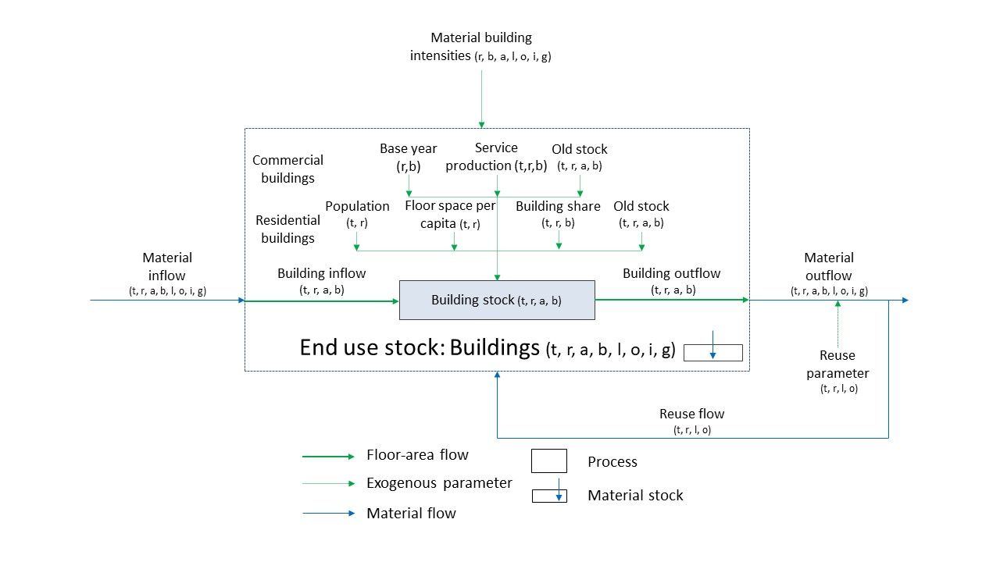

******************************
Buildings
******************************

   Diagram for the buildings sub-module

Indices
========================

The following table presents the dimensions indexing the parameters and variables (stock and flows)
of the MFA model for buildings.

.. csv-table::
    :header-rows: 1
    :file: tables/indices_buildings.csv

Parameters
========================

The following table presents the data structure and signification of all
input parameters expected by the MFA model for buildings.

.. csv-table::
    :header-rows: 1
    :file: tables/parameters_buildings.csv

Variables
========================

The following table presents the data structure and signification of
the variables generated by the MFA model for buildings.

.. csv-table::
    :header-rows: 1
    :file: tables/variables_buildings.csv

Processes
========================

The following table lists the processes in the MFA model for buildings.
We then provide a short description in plain English, an explanation of the exogenous parameters
and model variables, and an algebraic formulation of the equations governing the process.

.. csv-table::
    :header-rows: 1
    :file: tables/processes_buildings.csv

Process (EUSBuild) “End use stock: Buildings”
-----------------------------------------------

Short description
^^^^^^^^^^^^^^^^^^^^^^^^^^^^^^^

For residential (R) buildings the parameters population (P), space per capita (SC), and
building share (BS) are translated into the required residential stock. For commercial (C)
buildings, production of market and non-market services (SP) is converted into a sectoral
growth rate (GR) considering an elasticity of 30 %. Base year (BY) stock and GR are
translated to the required commercial stock. Required residential stock, required
commercial stock and old stock determine new constructed building stock per year. The new
constructed building stock can be zero or higher and its summation with the old stock,
considering age cohorts, determine the building stock. The construction and demolition of
buildings as building inflows and outflows are derived from the new constructed building
stock per year. Demolition occurs only in old cohorts, whereas construction occurs only in
new age cohorts. The building inflows and outflows are translated into material (M) inflows
and outflows using the respective material intensities (MI). The reuse fraction (RF) is
further used to compute the material portion that goes back into stock. The inflow and
outflow are then recomputed to project the impact of reuse on demand and waste.
Consequently, this process can provide input for the demand side and the waste generation
side after consolidation with the other end-use sectors.

Exogenous parameters
^^^^^^^^^^^^^^^^^^^^^^^^^^^^^^^

The parameter population defines the change in population differentiated by time and
region. The parameter space per capita defines square metre needed by inhabitants
differentiated by time and region. The parameter building share defines the share of
residential buildings type differentiated by time, region and building type. The parameter
base year defines the commercial building stock for a required base year differentiated by
region and building type. The parameter service production is a monetary value of
production of market and non-market services, which is used as driver for commercial
building stock development, differentiated by time, region, and building type. The
parameter old stock represents the residential and commercial old stock age cohort
differentiated by time, region, building type and age cohort. The parameter material
intensity defines the share of material per square metre differentiated by building type
and age cohort. The reuse parameter represents the material fraction re-entering the stock,
differentiated by time, region, and material product.

Model variables
^^^^^^^^^^^^^^^^^^^^^^^^^^^^^^^

The variable building in- and outflow are determined from the construction and demolition
of buildings based on the required and old stock. The variables material in- and outflows
are determined from the building in- and outflow as well as the material intensity. The
variable reuse flow is computed from the material outflows from buildings and the reuse
parameter.

Algebraic formulation
^^^^^^^^^^^^^^^^^^^^^^^^^^^^^^^

Residential buildings:

::

    R_Stock_Required_y = P * SC * BS

Commercial buildings:

::

    GR_y               = (SP_y / SP_(y-1)) - 1
    GR_y_Reduced       = GR_y * 0.3 + 1
    C_Stock_Required_y = C_Stock_Required_(y-1) * GR_y_Reduced,   for y > y₀
    C_Stock_Required_y₀ = BY

Combined:

::

    New_Stock          = Stock_Required - Stock_Old_Total,        New_Stock >= 0
    Building_stock     = Stock_Old + Stock_New
                         old stock retains existing age cohorts; new stock is
                         assigned to the cohort of its construction period.
    Building_Inflow    = Stock_Building - Stock_Building_(y-1),   for cohorts after the calibration year
    Building_Outflow   = Stock_Building - Stock_Building_(y-1),   for cohorts before the calibration year
    M_Inflow_Building  = MI_Building * Building_Inflow
    M_Outflow_Building = MI_Building * Building_Outflow
    M_Stock_Building   = MI_Building * Stock_Building
    M_Reuse_Building   = M_Outflow_Building * RF_Building
    M_Inflow_net_Building  = M_Inflow_Building - M_Reuse_Building
    M_Outflow_net_Building = M_Outflow_Building - M_Reuse_Building
