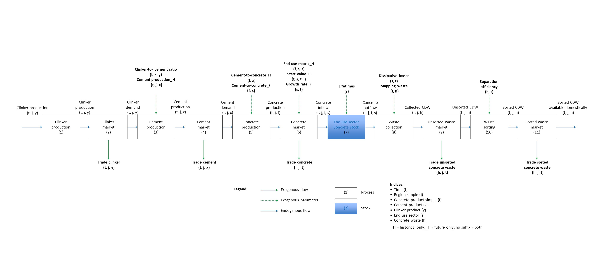

******************************
Cement
******************************

   Diagram for the cement sub-module

Indices
========================

The following table presents the dimensions indexing the parameters and variables (stock and flows) of the MFA model for cement.

.. csv-table::
    :header-rows: 1
    :file: tables/indices_cement.csv

Parameters
========================

The following table presents the data structure and signification of all input parameters expected by the MFA model for cement.

.. csv-table::
    :header-rows: 1
    :file: tables/parameters_cement.csv

Variables
========================

The following table presents the data structure and signification of the variables generated by the MFA model for cement.

.. csv-table::
    :header-rows: 1
    :file: tables/variables_cement.csv

Processes
========================

The following table lists the processes in the MFA model for cement. We then provide a short description in plain English, an explanation of the exogenous parameters and model variables, and an algebraic formulation of the equations governing the process. Every process exists twice, once for the historic chain and once for the future chain

.. csv-table::
    :header-rows: 1
    :file: tables/processes_cement.csv

Processes of the historic chain
===============================

The following describes each process in the historical chain in the order in which it is computed. For each process, we provide a short description in plain English, an explanation of the exogenous parameters and model variables, and an algebraic formulation.

Process (ProdCeH) “Production of cement historic”
-------------------------------------------------

Short description
^^^^^^^^^^^^^^^^^^^^^^^^^^^^^^^

This process determines the historic cement (Ce) production and the historic clinker demand. It is the entry point of the historic chain, so every other historic flow is derived from it. The clinker_factor converts the cement produced into the clinker required.

Exogenous parameters
^^^^^^^^^^^^^^^^^^^^^^^^^^^^^^^

The parameter cement production gives cement production by region and cement product. The parameter clinker_factor indicates how much clinker is contained in cement, a value below one.

Model variables
^^^^^^^^^^^^^^^^^^^^^^^^^^^^^^^

The cement production is read directly from the parameter. The clinker demand is determined from the cement production and the clinker_factor.

Algebraic formulation
^^^^^^^^^^^^^^^^^^^^^^^^^^^^^^^

::

    Ce_Production = cement_production
    Cl_Demand = Ce_Production * clinker_factor

Process (MarClH) “Market for clinker historic”
-----------------------------------------------

Short description
^^^^^^^^^^^^^^^^^^^^^^^^^^^^^^^

This process determines the historic clinker (Cl) production from the domestic clinker demand and trade.

Exogenous parameters
^^^^^^^^^^^^^^^^^^^^^^^^^^^^^^^

The parameter trade indicates the net exports of clinker.

Model variables
^^^^^^^^^^^^^^^^^^^^^^^^^^^^^^^

The model variable clinker production is determined from clinker demand and the trade. The clinker demand is a result of the previous process.

Algebraic formulation
^^^^^^^^^^^^^^^^^^^^^^^^^^^^^^^

::

    Cl_Production = Cl_Demand - Cl_Trade

Process (ProdClH) “Production of clinker historic”
--------------------------------------------------

Short description
^^^^^^^^^^^^^^^^^^^^^^^^^^^^^^^

This process indicates the historic production of clinker (Cl) driven by the subsequent processes, i.e. trade, production and demand.

Exogenous parameters
^^^^^^^^^^^^^^^^^^^^^^^^^^^^^^^

None.

Model variables
^^^^^^^^^^^^^^^^^^^^^^^^^^^^^^^

The model variable clinker production corresponds to the outflow of this process.

Algebraic formulation
^^^^^^^^^^^^^^^^^^^^^^^^^^^^^^^

::

    None.

Process (MarCeH) “Market for cement historic”
-----------------------------------------------

Short description
^^^^^^^^^^^^^^^^^^^^^^^^^^^^^^^

This process determines the historic domestic cement (Ce) demand from the cement production and trade.

Exogenous parameters
^^^^^^^^^^^^^^^^^^^^^^^^^^^^^^^

The parameter trade cement indicates the net exports of cement.

Model variables
^^^^^^^^^^^^^^^^^^^^^^^^^^^^^^^

The domestic cement demand is determined from the cement production and trade.

Algebraic formulation
^^^^^^^^^^^^^^^^^^^^^^^^^^^^^^^

::

    Ce_Demand = Ce_Production - Ce_Trade

Process (ProdCoH) “Production of concrete historic”
---------------------------------------------------

Short description
^^^^^^^^^^^^^^^^^^^^^^^^^^^^^^^

This process determines the historic concrete (Co) production from the domestic cement demand.

Exogenous parameters
^^^^^^^^^^^^^^^^^^^^^^^^^^^^^^^

The parameter cement-to-concrete determines the use of cement in concrete.

Model variables
^^^^^^^^^^^^^^^^^^^^^^^^^^^^^^^

The model variable concrete production is determined from the cement demand and the use of concrete in cement. The cement demand is a result of the previous process.

Algebraic formulation
^^^^^^^^^^^^^^^^^^^^^^^^^^^^^^^

::

    Co_Production = Ce_Demand * cement_to_concrete_historic

Process (MarCoH) “Market of concrete historic”
-----------------------------------------------

Short description
^^^^^^^^^^^^^^^^^^^^^^^^^^^^^^^

This process determines the historical domestic demand for concrete (Co) as an inflow to the end-use sectors by translating concrete production based on trade data and the end-use matrix.

Exogenous parameters
^^^^^^^^^^^^^^^^^^^^^^^^^^^^^^^

The parameter trade concrete indicates the net exports of concrete. The parameter end use matrix determines the shares of the end use sectors.

Model variables
^^^^^^^^^^^^^^^^^^^^^^^^^^^^^^^

The concrete inflow is determined from the concrete production, the trade and the end use matrix.

Algebraic formulation
^^^^^^^^^^^^^^^^^^^^^^^^^^^^^^^

::

    Co_Inflow = (Co_Production - Co_Trade) * end_use_matrix

Process (EUSAllH) “End use stock historic”
-----------------------------------------------

Short description
^^^^^^^^^^^^^^^^^^^^^^^^^^^^^^^

This process determines the historical concrete (Co) stock and outflow. The stock and its outflow are calculated using the mean and standard deviation of the concrete lifetime.

Exogenous parameters
^^^^^^^^^^^^^^^^^^^^^^^^^^^^^^^

The parameter lifetimes indicates the mean and standard deviation per end use sector.

Model variables
^^^^^^^^^^^^^^^^^^^^^^^^^^^^^^^

The stock is determined from the inflow and the lifetime distribution, by tracking the surviving share of each inflow cohort. The outflow is determined from the same cohorts as the share that has reached the end of its lifetime.

Algebraic formulation
^^^^^^^^^^^^^^^^^^^^^^^^^^^^^^^

::

    Co_Outflow = Co_Inflow * LifetimeDist
    Co_Stock_Change = Co_Inflow - Co_Outflow
    Co_Stock = Co_Stock(t-1) + Co_Stock_Change

Process (WCCoH) “Waste collection of concrete historic”
-------------------------------------------------------

Short description
^^^^^^^^^^^^^^^^^^^^^^^^^^^^^^^

This process determines historic collected concrete (Co) waste, which are determined by the outflows from the concrete stock and dissipative losses. Then maps the collected concrete to concrete waste types.

Exogenous parameters
^^^^^^^^^^^^^^^^^^^^^^^^^^^^^^^

The parameter dissipative losses determines how much of concrete is available for collection at the end of life. The parameter mapping waste maps concrete products to concrete waste types.

Model variables
^^^^^^^^^^^^^^^^^^^^^^^^^^^^^^^

The model variable collected concrete waste is determined from the concrete outflow and dissipative losses. The concrete outflow is determined by the end use sectors described above.

Algebraic formulation
^^^^^^^^^^^^^^^^^^^^^^^^^^^^^^^

::

    Co_Waste_Collected = Co_Outflow * DissLosses * Mapping_Waste

Process (UWMCoH) “Unsorted waste market for concrete waste historic”
--------------------------------------------------------------------

Short description
^^^^^^^^^^^^^^^^^^^^^^^^^^^^^^^

This process determines how much historic collected concrete (Co) waste is available for sorting. It considerd the collected concrete waste and trade.

Exogenous parameters
^^^^^^^^^^^^^^^^^^^^^^^^^^^^^^^

The parameter trade unsorted concrete waste indicates the net exports of unsorted CDW.

Model variables
^^^^^^^^^^^^^^^^^^^^^^^^^^^^^^^

The unsorted waste available domestically is determined from the collected waste and trade.

Algebraic formulation
^^^^^^^^^^^^^^^^^^^^^^^^^^^^^^^

::

    CDW_ForSorting = CDW_Unsorted - CDW_Unsorted_Trade

Process (WSCoH) “Waste sorting of concrete waste historic”
----------------------------------------------------------

Short description
^^^^^^^^^^^^^^^^^^^^^^^^^^^^^^^

This process determines how much of the unsorted CDW is sorted.

Exogenous parameters
^^^^^^^^^^^^^^^^^^^^^^^^^^^^^^^

The parameter separation efficiency indicates the share of unsorted waste that is sorted.

Model variables
^^^^^^^^^^^^^^^^^^^^^^^^^^^^^^^

The sorted waste is determined from the unsorted waste available for sorting and the separation efficiency.

Algebraic formulation
^^^^^^^^^^^^^^^^^^^^^^^^^^^^^^^

::

    CDW_Sorted = CDW_ForSorting * separation_efficiency

Process (SWMCoH) “Sorted waste market for concrete waste historic”
------------------------------------------------------------------

Short description
^^^^^^^^^^^^^^^^^^^^^^^^^^^^^^^

This process determines historic sorted concrete waste available domestically from the the sorted concrete waste and trade.

Exogenous parameters
^^^^^^^^^^^^^^^^^^^^^^^^^^^^^^^

The parameter trade sorted concrete waste indicates the net exports of sorted CDW.

Model variables
^^^^^^^^^^^^^^^^^^^^^^^^^^^^^^^

The sorted waste available domestically is determined from the sorted waste and trade.

Algebraic formulation
^^^^^^^^^^^^^^^^^^^^^^^^^^^^^^^

::

    CDW_Available = CDW_Sorted - CDW_Sorted_Trade

Processes of the future chain
=============================

The following sections describe each process of the future chain in the order it is computed. The future chain uses the same processes as the historic chain but computes them in the opposite direction. It starts from the concrete market, where demand is built from the start value and the growth rate and works upstream to clinker production.

Process (MarCoF) “Market of concrete future”
-----------------------------------------------

Short description
^^^^^^^^^^^^^^^^^^^^^^^^^^^^^^^

This process determines the future domestic demand for concrete (Co) from the concrete start value, the demand in the base year, and the concrete growth rate. The growth rate is derived from monetary data on construction demand growth (CDG), damped by an elasticity of change of 30 per cent. The demand enters the end use sectors as an inflow to the stock.

Exogenous parameters
^^^^^^^^^^^^^^^^^^^^^^^^^^^^^^^

The parameter start value indicates the concrete demand in the base year. The parameter CDG gives the cumulative relative growth in construction demand since the base year.

Model variables
^^^^^^^^^^^^^^^^^^^^^^^^^^^^^^^

The model variable concrete demand is determined from the start value and the growth rate.

Algebraic formulation
^^^^^^^^^^^^^^^^^^^^^^^^^^^^^^^

::

    Co_GR = CDG * 0.3 + 1
    Co_Demand = Co_GR * Co_SV

Process (EUSAllF) “End use stock future”
-----------------------------------------------

Short description
^^^^^^^^^^^^^^^^^^^^^^^^^^^^^^^

This process determines the future concrete (Co) stock and outflow. The stock and its outflow are calculated using the mean and standard deviation of the concrete lifetime.

Exogenous parameters
^^^^^^^^^^^^^^^^^^^^^^^^^^^^^^^

The parameter lifetimes indicates the mean and standard deviation per end use sector.

Model variables
^^^^^^^^^^^^^^^^^^^^^^^^^^^^^^^

The stock is determined from the inflow and the lifetime distribution, by tracking the surviving share of each inflow cohort. The outflow is determined from the same cohorts as the share that has reached the end of its lifetime. The concrete inflow is a result of the previous process.

Algebraic formulation
^^^^^^^^^^^^^^^^^^^^^^^^^^^^^^^

::

    Co_Outflow = Co_Inflow * LifetimeDist
    Co_Stock_Change = Co_Inflow - Co_Outflow
    Co_Stock = Co_Stock(t-1) + Co_Stock_Change

Process (ProdCoF) “Production of concrete future”
-------------------------------------------------

Short description
^^^^^^^^^^^^^^^^^^^^^^^^^^^^^^^

This process determines the future concrete (Co) production from the domestic concrete demand and trade. The end use sectors are summed here, because concrete production is not tracked per sector.

Exogenous parameters
^^^^^^^^^^^^^^^^^^^^^^^^^^^^^^^

The parameter trade concrete indicates the net exports of concrete.

Model variables
^^^^^^^^^^^^^^^^^^^^^^^^^^^^^^^

The model variable concrete production is determined from the concrete demand and the trade. The concrete demand is a result of the previous process.

Algebraic formulation
^^^^^^^^^^^^^^^^^^^^^^^^^^^^^^^

::

    Co_Production = Co_Demand - Co_Trade

Process (MarCeF) “Market for cement future”
-----------------------------------------------

Short description
^^^^^^^^^^^^^^^^^^^^^^^^^^^^^^^

This process determines the future cement (Ce) demand from the concrete production.

Exogenous parameters
^^^^^^^^^^^^^^^^^^^^^^^^^^^^^^^

The parameter cement-to-concrete determines the use of cement in concrete.

Model variables
^^^^^^^^^^^^^^^^^^^^^^^^^^^^^^^

The model variable cement demand is determined from the concrete production and the use of cement in concrete. The concrete production is a result of the previous process.

Algebraic formulation
^^^^^^^^^^^^^^^^^^^^^^^^^^^^^^^

::

    Ce_Demand = Co_Production * cement_to_concrete_future

Process (ProdCeF) “Production of cement future”
-----------------------------------------------

Short description
^^^^^^^^^^^^^^^^^^^^^^^^^^^^^^^

This process determines the future cement (Ce) production from the domestic cement demand and trade, and the future clinker demand. The clinker_factor converts the cement produced into the clinker required to make it.

Exogenous parameters
^^^^^^^^^^^^^^^^^^^^^^^^^^^^^^^

The parameter trade cement indicates the net exports of cement. The parameter clinker_factor indicates how much clinker is contained in cement, a value below one.

Model variables
^^^^^^^^^^^^^^^^^^^^^^^^^^^^^^^

The cement production is determined from the cement demand and the trade. The clinker demand is determined from the cement production and the clinker_factor.

Algebraic formulation
^^^^^^^^^^^^^^^^^^^^^^^^^^^^^^^

::

    Ce_Production = Ce_Demand - Ce_Trade
    Cl_Demand = Ce_Production * clinker_factor

Process (MarClF) “Market for clinker future”
-----------------------------------------------

Short description
^^^^^^^^^^^^^^^^^^^^^^^^^^^^^^^

This process determines the future clinker (Cl) production from the domestic clinker demand and trade.

Exogenous parameters
^^^^^^^^^^^^^^^^^^^^^^^^^^^^^^^

The parameter trade indicates the net exports of clinker.

Model variables
^^^^^^^^^^^^^^^^^^^^^^^^^^^^^^^

The model variable clinker production is determined from clinker demand and the trade. The clinker demand is a result of the previous process.

Algebraic formulation
^^^^^^^^^^^^^^^^^^^^^^^^^^^^^^^

::

    Cl_Production = Cl_Demand - Cl_Trade

Process (ProdClF) “Production of clinker future”
------------------------------------------------

Short description
^^^^^^^^^^^^^^^^^^^^^^^^^^^^^^^

This process indicates the future production of clinker (Cl) driven by the subsequent processes, i.e. trade, production and demand.

Exogenous parameters
^^^^^^^^^^^^^^^^^^^^^^^^^^^^^^^

None.

Model variables
^^^^^^^^^^^^^^^^^^^^^^^^^^^^^^^

The model variable clinker production corresponds to the outflow of this process.

Algebraic formulation
^^^^^^^^^^^^^^^^^^^^^^^^^^^^^^^

::

    None.

Process (WCCoF) “Waste collection of concrete future”
-----------------------------------------------------

Short description
^^^^^^^^^^^^^^^^^^^^^^^^^^^^^^^

This process determines future collected concrete (Co) waste, which are determined by the outflows from the concrete stock and dissipative losses. Then maps the collected concrete to concrete waste types.

Exogenous parameters
^^^^^^^^^^^^^^^^^^^^^^^^^^^^^^^

The parameter dissipative losses determines, how much of concrete is available for collection at the end of life. The parameter mapping waste maps concrete products to concrete waste types.

Model variables
^^^^^^^^^^^^^^^^^^^^^^^^^^^^^^^

The model variable collected concrete waste is determined from the concrete outflow and dissipative losses. The concrete outflow is determined by the end use sectors described above.

Algebraic formulation
^^^^^^^^^^^^^^^^^^^^^^^^^^^^^^^

::

    Co_Waste_Collected = Co_Outflow * DissLosses * mapping_waste

Process (UWMCoF) “Unsorted waste market for concrete waste future”
------------------------------------------------------------------

Short description
^^^^^^^^^^^^^^^^^^^^^^^^^^^^^^^

This process determines how much future collected concrete (Co) waste is available for sorting. It considers the collected concrete waste and trade.

Exogenous parameters
^^^^^^^^^^^^^^^^^^^^^^^^^^^^^^^

The parameter trade unsorted concrete waste indicates the net exports of unsorted CDW.

Model variables
^^^^^^^^^^^^^^^^^^^^^^^^^^^^^^^

The unsorted waste available domestically is determined from the collected waste and trade.

Algebraic formulation
^^^^^^^^^^^^^^^^^^^^^^^^^^^^^^^

::

    CDW_ForSorting = CDW_Unsorted - CDW_Unsorted_Trade

Process (WSCoF) “Waste sorting of concrete waste future”
--------------------------------------------------------

Short description
^^^^^^^^^^^^^^^^^^^^^^^^^^^^^^^

This process determines how much of the unsorted CDW is sorted.

Exogenous parameters
^^^^^^^^^^^^^^^^^^^^^^^^^^^^^^^

The parameter separation efficiency indicates the share of unsorted waste that is sorted.

Model variables
^^^^^^^^^^^^^^^^^^^^^^^^^^^^^^^

The sorted waste is determined from the unsorted waste available for sorting and the separation efficiency.

Algebraic formulation
^^^^^^^^^^^^^^^^^^^^^^^^^^^^^^^

::

    CDW_Sorted = CDW_ForSorting * separation_efficiency

Process (SWMCoF) “Sorted waste market for concrete waste future”
----------------------------------------------------------------

Short description
^^^^^^^^^^^^^^^^^^^^^^^^^^^^^^^

This process determines future sorted concrete waste available domestically from the sorted concrete waste and trade.

Exogenous parameters
^^^^^^^^^^^^^^^^^^^^^^^^^^^^^^^

The parameter trade sorted concrete waste indicates the net exports of sorted CDW.

Model variables
^^^^^^^^^^^^^^^^^^^^^^^^^^^^^^^

The sorted waste available domestically is determined from the sorted waste and trade.

Algebraic formulation
^^^^^^^^^^^^^^^^^^^^^^^^^^^^^^^

::

    CDW_Available = CDW_Sorted - CDW_Sorted_Trade
