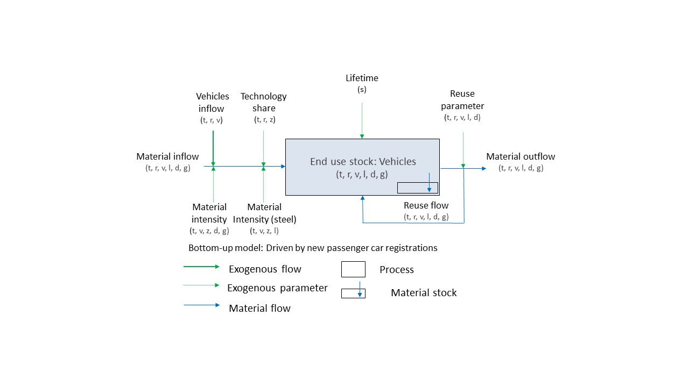

******************************
Vehicles
******************************

   Diagram for the vehicles sub-module

Indices
========================

The following table presents the dimensions indexing the parameters and variables (stock and flows)
of the MFA model for vehicles.

.. csv-table::
    :header-rows: 1
    :file: tables/indices_vehicles.csv

Parameters
========================

The following table presents the data structure and signification of all
input parameters expected by the MFA model for vehicles.

.. csv-table::
    :header-rows: 1
    :file: tables/parameters_vehicles.csv

Variables
========================

The following table presents the data structure and signification of
the variables generated by the MFA model for vehicles.

.. csv-table::
    :header-rows: 1
    :file: tables/variables_vehicles.csv

Processes
========================

The following table lists the processes in the MFA model for vehicles.
We then provide a short description in plain English, an explanation of the exogenous parameters
and model variables, and an algebraic formulation of the equations governing the process.

.. csv-table::
    :header-rows: 1
    :file: tables/processes_vehicles.csv

Process (EUSVeh) “End use stock: Vehicles”
-----------------------------------------------

Short description
^^^^^^^^^^^^^^^^^^^^^^^^^^^^^^^

Within this process, the new registration of vehicles for passenger transport is first
distributed across vehicle sizes by multiplying it by the technology share (TS) and then
translated into material (M) inflows and outflows using the respective material
intensities (MI). Based on the evolution of new registrations, the demand for new vehicles
is determined, which reflects material inflows. Material outflows are determined based on
the material inflows and lifetime distributions. The reuse fraction (RF) is further used to
compute the material portion that goes back into stock. The inflow and outflow are then
recomputed to project the impact of reuse on demand and waste. Consequently, this process
can provide input for the demand side and waste generation after consolidation with the
other end-use sectors.

Exogenous flow
^^^^^^^^^^^^^^^^^^^^^^^^^^^^^^^

The vehicle model is driven by the exogenous flow of new vehicle registrations, which
defines the development of new registrations differentiated by time, vehicle type, and
region. New vehicle registrations are based on Eurostat data for the base year and the
trajectory is rescaled according to the OPEN-PROM scenario for the change in flow by time,
vehicle type and region.

Exogenous parameters
^^^^^^^^^^^^^^^^^^^^^^^^^^^^^^^

The material intensity parameter defines the material share per passenger vehicle,
differentiated by time and vehicle type. The technology share parameter defines the share
of vehicle sizes, differentiated by time and region. The reuse parameter represents the
material fraction re-entering the stock, differentiated by time, region and product.

Model variables
^^^^^^^^^^^^^^^^^^^^^^^^^^^^^^^

The variable material inflow is determined from the demand for new cars, technology share
and material intensity. The variable material outflow is determined from the material
inflow and the lifetime distribution.

Algebraic formulation
^^^^^^^^^^^^^^^^^^^^^^^^^^^^^^^

::

    M_Inflow_Cars      = TS_Cars * MI_Cars * Cars_Inflow
    M_Outflow_Cars     = M_Inflow_Cars * LifetimeDist
    M_Reuse_Cars       = M_Outflow_Cars * RF_Cars
    M_Inflow_net_Cars  = M_Inflow_Cars - M_Reuse_Cars
    M_Outflow_net_Cars = M_Outflow_Cars - M_Reuse_Cars
